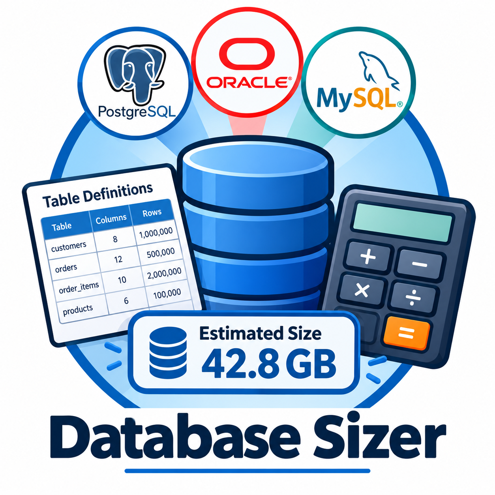

# Database Sizer

Estimate disk and memory for PostgreSQL, MySQL/MariaDB (InnoDB), SQL Server and Oracle from table definitions.

**Run:** open `index.html` in a browser. No install, build step, or network access.

- `vendor/d3.min.js` – d3 v7.9.0 (ISC licence in `vendor/LICENSE-d3.txt`), the only third-party code.
- `js/engine.js` – per-vendor row/index layout models and the disk/memory/growth roll-up.
- `js/help.js` – learning content: field help popovers and per-vendor storage notes (edit this to change the text).
- `js/ddl.js` – CREATE TABLE / CREATE INDEX parser. `js/charts.js` – d3 charts. `js/app.js` – UI.

Input: grid editor, pasted DDL, or JSON import/export. The model autosaves to browser localStorage; results export to CSV.
Row counts accept suffixes (`2.5M`, `400k`). All figures are estimates.
